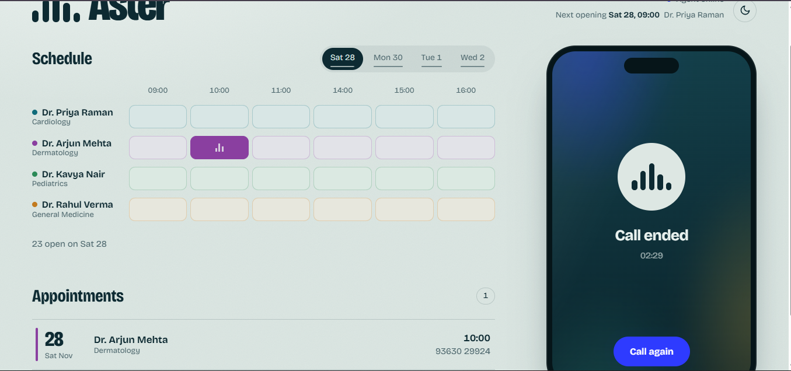
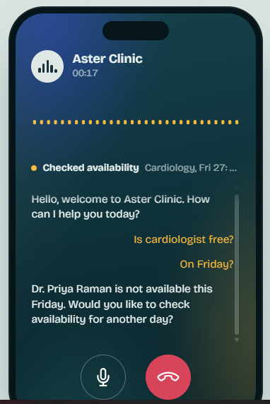
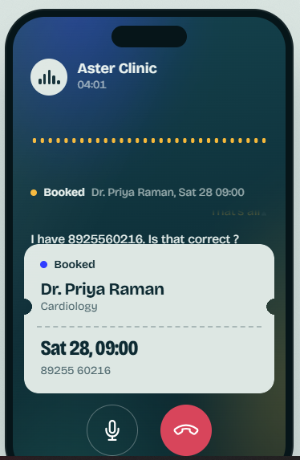
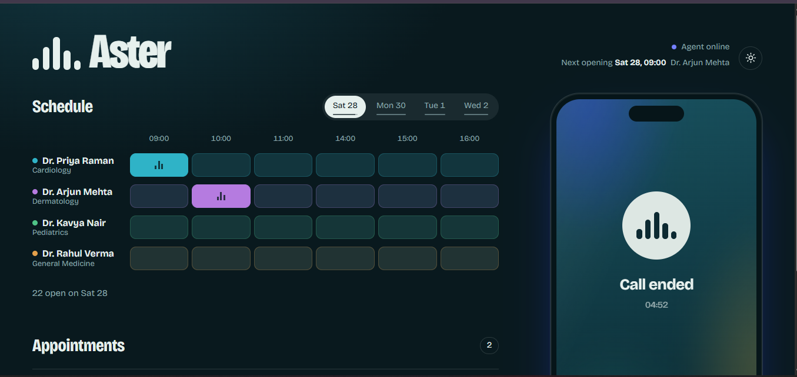
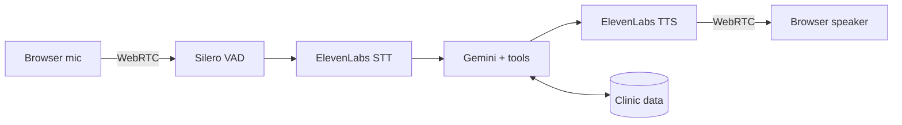

<p align="center">
  
</p>

<h1 align="center">Aster</h1>

<p align="center">
  A voice receptionist for a doctor's clinic. Call it from the browser,<br>
  say your phone number, and it books or cancels an appointment while you watch.
</p>

<p align="center">
  
  
  
  
</p>

<p align="center">
  
</p>

Built for the NexovAI SDE Intern Round 1 assignment.

## What it does

A caller talks to the agent in the browser. The agent can check a doctor's availability, book a slot, and cancel an appointment. It knows the caller only by the phone number they say out loud, and it reads that number back before it books or cancels. The dashboard next to the call shows the live transcript, each doctor's timetable, and the appointments, which update the moment the agent acts.

<p align="center">
  
  &nbsp;&nbsp;
  
</p>

<p align="center">
  
</p>

## How it works

The browser opens a WebRTC connection to the server, and each call runs one Pipecat pipeline.



Silero VAD finds where the caller starts and stops talking. The agent waits 0.8 seconds of silence before it answers, so a phone number said in pieces stays in one turn.

Gemini can call three tools, registered inside the pipeline:

- `check_doctor_availability(doctor?, date?)` returns open slots, filtered by doctor, speciality or date.
- `book_appointment(phone, doctor, date, time)` books a slot.
- `cancel_appointment(phone)` cancels the appointment for that number.

The prompt tells the agent to read the number back digit by digit and wait for a yes before it books or cancels. That read-back is enforced by the prompt, not by code.

Doctors, slots and appointments are mock data in memory (`backend/clinic.py`). The dashboard polls the server for changes, so when the agent books or cancels, the matching timetable cell flashes, the appointment list updates, and a ticket appears in the phone. Every tool call also shows in a small activity line under the waveform.

## Stack

| Part | Choice |
| --- | --- |
| Voice pipeline | Pipecat 1.17 (Python), SmallWebRTC transport |
| Speech to text | ElevenLabs |
| Text to speech | ElevenLabs (voice: Sarah, a built-in voice that works on the free plan) |
| LLM | Google Gemini, `gemini-3.5-flash-lite` (free tier) |
| Voice activity detection | Silero VAD |
| API | FastAPI |
| Dashboard | React + Vite, plain CSS |

## Run it

You need Python 3.10+, Node 18+, and two API keys: Gemini (aistudio.google.com/apikey) and ElevenLabs.

**1. Backend** (Windows PowerShell; on macOS or Linux use `source .venv/bin/activate` and `cp`)

```
python -m venv .venv
.\.venv\Scripts\Activate.ps1
pip install -r requirements.txt
copy .env.example .env
```

Open `.env`, add your two keys, then:

```
cd backend
uvicorn server:app --port 8000
```

**2. Frontend** (second terminal)

```
cd frontend
npm install
npm run dev
```

Open http://localhost:5173 and click **Try call**. Use headphones, otherwise the agent hears itself.

Optional settings in `.env`: `GEMINI_MODEL` and `ELEVENLABS_VOICE_ID`. The dashboard finds the server at `http://127.0.0.1:8000`; set `VITE_API_URL` to change that.

## Frontend

A timetable grid (doctors by hour) instead of cards, one colour per doctor, a phone-style call screen (ringing, connected, ended, with timer, mute, end, live transcript and waveform), a booking ticket, a logo that moves with the voices, ring and end-call sounds, light and dark themes, and a layout that works on mobile.

## Project layout

```
backend/
  bot.py        Pipecat pipeline, prompt, tool definitions
  clinic.py     mock doctors, slots, booking logic
  activity.py   records tool calls for the dashboard
  server.py     FastAPI: WebRTC signalling and dashboard endpoints
frontend/src/
  App.jsx       dashboard, phone, timetable
  hooks.js      call connection, polling
  lib.js        formatting and call sounds
  index.css     styles, light and dark themes
docs/           logo and screenshots
```

## Limits

- Data is in memory. Restarting the server clears all appointments.
- Slots cover the next five days, skipping Sundays, and are generated when the server starts.
- The Gemini free tier allows only a small number of requests per day per model (about 20 when I tested), so long testing can use it up.
- The ElevenLabs free plan has a monthly character limit and cannot use library voices through the API, which is why the default voice is a built-in one.
- Speech-to-text can mishear names, so the prompt lists the doctors and tells the agent to map what it hears to the closest one.
- Pipecat's SmallWebRTC works on a local network. A public deployment would need HTTPS and likely a TURN server, so this repo is meant to be run locally.
